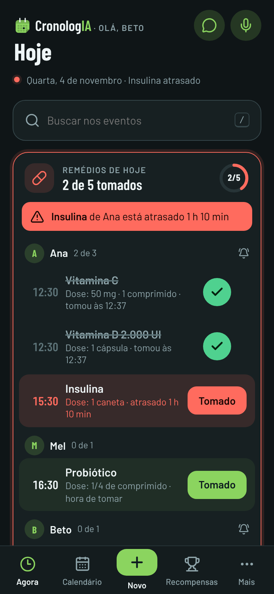
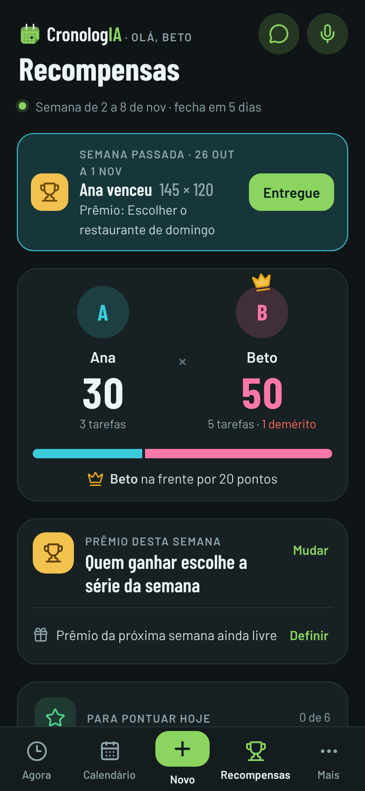
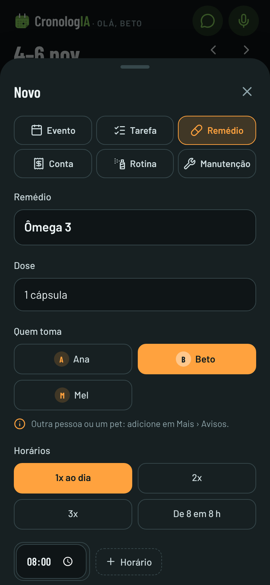
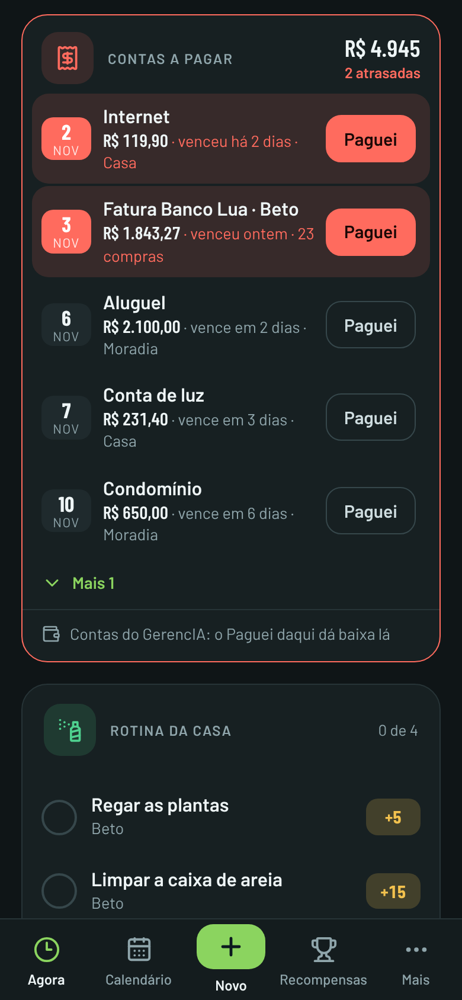
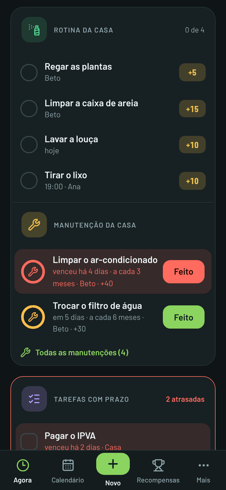
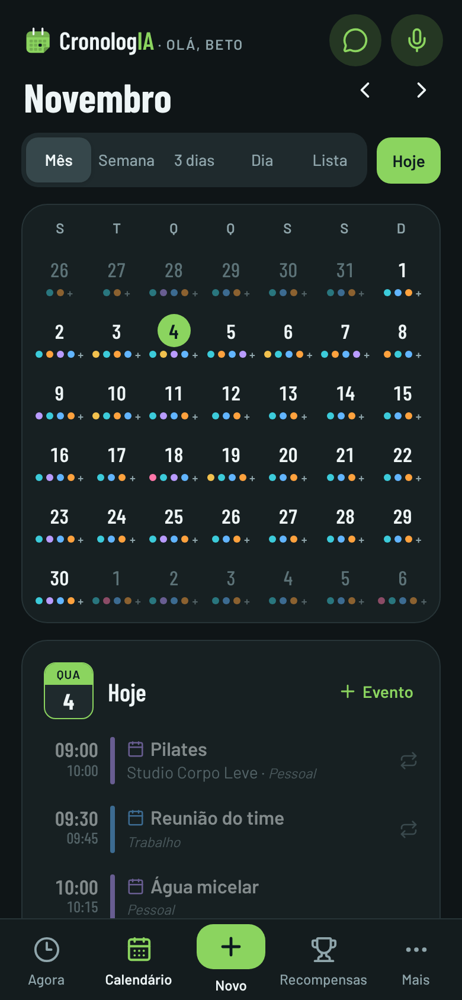
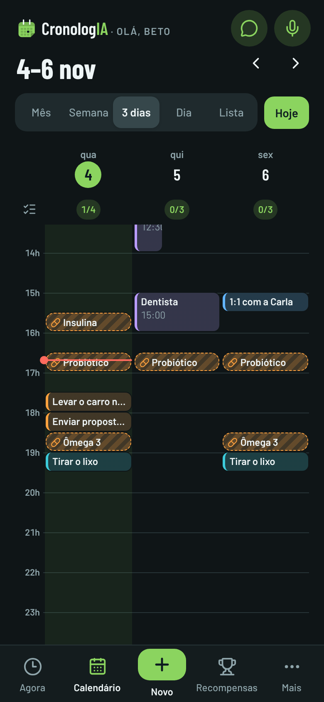
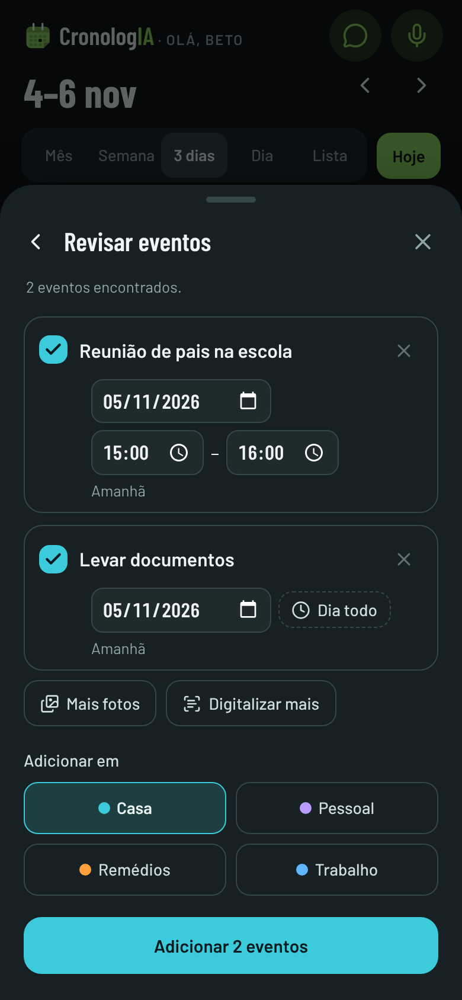

# CronologIA para Home Assistant


Um App do Home Assistant que mostra os **calendários nativos** (`calendar.*`) numa agenda bonita: o que está acontecendo agora, o mês, a semana e o dia, com cores por calendário. Cria, edita e apaga eventos nos calendários que permitem (local, Google, Outlook…), tem **modelos de remédio (com aviso no celular), conta a pagar, rotina e manutenção da casa**, um **placar de recompensas** para as tarefas e **traz eventos de mensagens, fotos e arquivos .ics** com a IA do Home Assistant.

<p align="center">
  
  
  
  
</p>
<p align="center">
  
  
  
  
</p>

[](https://my.home-assistant.io/redirect/supervisor_add_addon_repository/?repository_url=https%3A%2F%2Fgithub.com%2Fdiegozapella63%2Fcronologia-ha)

## Instalação

1. Toque no botão acima. Se preferir, no Home Assistant abra **Configurações → Aplicativos → Loja de aplicativos**, toque no menu **⋮ → Repositórios** e cole:
   ```
   https://github.com/diegozapella63/cronologia-ha
   ```
2. Procure **CronologIA** na loja, toque em **Instalar** e depois em **Iniciar**.
3. Ative **Mostrar na barra lateral**.

A primeira instalação leva alguns minutos, porque o app é montado no próprio Home Assistant.

## O que tem

- **Agora**, só o dia de hoje: os **remédios de hoje** de cada pessoa e pet (dose, quem toma; o atrasado em vermelho), as **contas a pagar**, o evento que está acontecendo (e quanto falta) ou o próximo, os de dia todo, a **rotina e a manutenção da casa** e as **tarefas** com prazo.
- **Calendário** por **mês, semana, 3 dias, dia ou lista**, com busca do último ano ao próximo. Toque num horário vazio para criar um evento ali.
- **Modelos** em Novo: **Remédio** (dose, quem toma, vários horários, todo dia, dia sim e dia não, dias da semana, por N dias), **Conta a pagar**, **Rotina da casa** (com período do dia, cômodos, **Pular** e a que volta N dias depois de feita) e **Manutenção** contada a partir da última vez, com um ou vários equipamentos.
- **Tarefas do ResolvIA**: as tarefas com prazo das listas do Home Assistant aparecem na Agora e no calendário, o **Concluir** daqui conclui lá, e **Novo › Tarefa** cria a tarefa numa lista, com cômodos. As **manutenções e rotinas** podem ir para uma lista do ResolvIA: concluir lá vale como feito aqui, com os pontos.
- **Cômodos e equipamentos** do [InventarIA](https://github.com/diegozapella63/inventario-ha), pelo ResolvIA: etiquetas curtas nas rotinas, manutenções e tarefas.
- **Recompensas**: placar da casa com pontos por tarefa feita, **deméritos** que tiram pontos, pontos avulsos, quem está na frente, o prêmio da semana (ou do mês), o histórico de quem venceu e um **lembrete diário** no celular com quem está ganhando (o toque abre as Recompensas).
- **Férias**: de quando até quando rotinas, tarefas, deméritos e manutenção ficam pausados (os remédios continuam), com um card na Agora para ninguém achar que sumiu tudo.
- **Aviso de remédio no celular** pelo app Home Assistant, com **Tomei** e **Adiar 15 min** no aviso, e de novo se atrasar, também para quem cuida (o remédio do pet vai para o celular de alguém).
- **Contas do GerencIA**: com o [GerencIA](https://github.com/diegozapella63/gerencia-ha) instalado, as contas e faturas aparecem aqui e o **Paguei** dá baixa lá.
- **CorrerIA**: com o [CorrerIA](https://github.com/diegozapella63/correria-ha), a agenda responde pelo WhatsApp, pelo Claude e pelo Gemini: o que tem hoje, criar e mudar compromissos, marcar como feito e dar pontos.
- **Falar**: toque no microfone e diga o compromisso; a IA monta o evento para você conferir.
- **Conversa com a IA**: pergunte "o que tenho hoje?" ou "quem está ganhando?", ou peça "marca dentista sexta às 15h"; cada ação aparece num cartão e só acontece quando você toca em **Fazer**.
- **Eventos de mensagem ou foto**: cole o convite do WhatsApp, escolha um print ou fotografe um cartão de consulta; a IA configurada no Home Assistant (Claude, OpenAI, Gemini ou Ollama) encontra data, horário e local, e você revisa. **Usar IA** desligado tira tudo o que usa IA.
- **Criar, editar e apagar** nos calendários que permitem, com **repetição** (só este ou este e os próximos) e **Desfazer**.
- **Arquivos .ics**: importar convites e exportar os calendários.
- **Sensores** de remédios e manutenção, e o evento `cronologia_feito` para automações e etiquetas NFC.
- **Dados**: exportar em ZIP, CSV ou JSON, backup em `share/cronologia`, importar e versões anteriores automáticas.
- **Mais, um menu**: Calendários (nome, cor e mostrar/ocultar de cada um, sincronizados entre aparelhos), Rotinas, Avisos, Férias, Configurações (Integrações, Placar, Dados, Aparência e Opções) e **Sobre**.
- **Outlook, Google e Alexa**: o Outlook entra pelo MS365 Calendar (HACS) ou por um link .ics; o Google, pela integração oficial; e o que você pede para a Alexa aparece quando ela usa uma dessas agendas.
- **Celular e computador**: feito para o celular; com a tela larga, barra lateral com um mês pequeno e os calendários.
- **Tema claro e escuro** seguindo o Home Assistant, e a **Cor do dia**: a cor do app muda todo dia (ou fica fixa na que você escolher).

Mais detalhes em [cronologia/DOCS.md](cronologia/DOCS.md).

## Estrutura

```
repository.yaml          repositório de apps
cronologia/              o app (config, Dockerfile, servidor Node.js)
frontend/                código-fonte da interface (Lit)
preview/                 prévia da interface com calendários de exemplo
docs/                    telas de exemplo do README (python3 tools/prints_readme.py)
tools/prints_readme.py   refaz as telas do README a partir da prévia, com nomes inventados
dev/fake-ha.mjs          Home Assistant falso para desenvolver sem o HA
```

## Desenvolvimento

Como trabalhar no projeto (checklist de cada mudança, versão, testes, arquivos em comum com os outros apps e como eles conversam): [AGENTS.md](AGENTS.md). Os testes: [tests/README.md](tests/README.md).

```bash
cd frontend && npm install && npm run build      # gera cronologia/rootfs/app/www/cronologia.js
TZ=America/Sao_Paulo node dev/fake-ha.mjs        # HA falso em :8123 (token "dev")
CRONOLOGIA_DEV=1 HA_WS_URL=ws://127.0.0.1:8123/api/websocket HA_REST_URL=http://127.0.0.1:8123/api \
  HA_TOKEN=dev DATA_DIR=./.data MEDIA_DIR=./.data/media SHARE_DIR=./.data/share node cronologia/rootfs/app/server.js
                                                 # abre em http://127.0.0.1:8099
```

O HA falso tem calendários de exemplo (local, "Outlook", feriados e um remoto só de leitura), repetição simples e duas IAs (`ai_task.google_ai_task`, que lê fotos, e `ai_task.ollama_ai_task`, só texto). Use `FAKE_MEDIA_DIR` igual a `MEDIA_DIR` para testar a leitura de fotos, `FAKE_HA_NO_AI=1` para testar sem IA e `FAKE_HA_OLD=1` para simular um Home Assistant sem `calendar/event/subscribe`. A prévia (`preview/cronologia-preview.html`) abre direto no navegador, sem servidor.

## Créditos

[Lit](https://lit.dev) (BSD-3-Clause), ícones [Lucide](https://lucide.dev) (ISC), fontes [Barlow](https://fonts.google.com/specimen/Barlow) e [Barlow Condensed](https://fonts.google.com/specimen/Barlow+Condensed) (SIL Open Font License).
