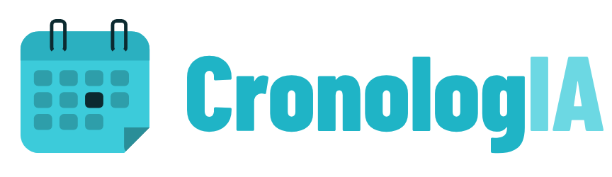
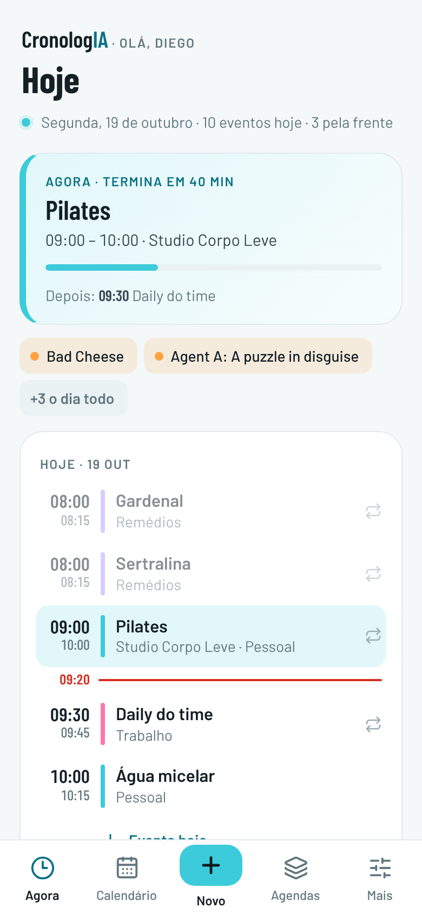
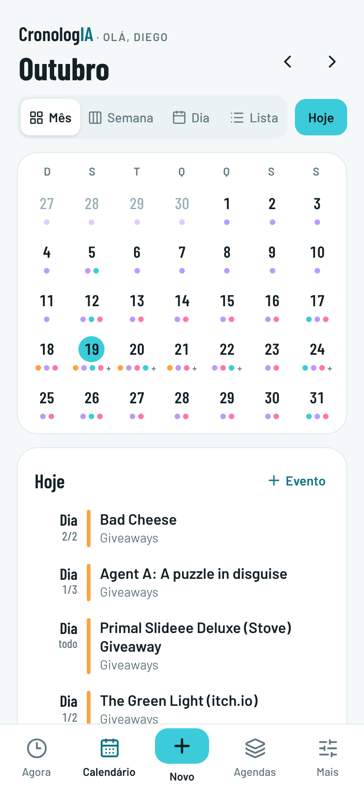
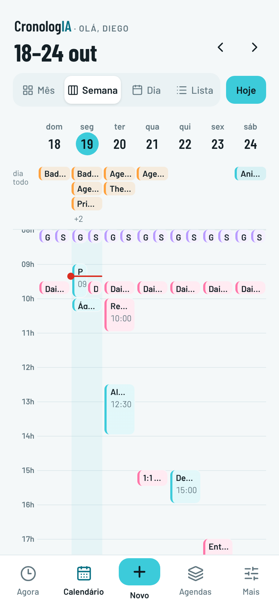
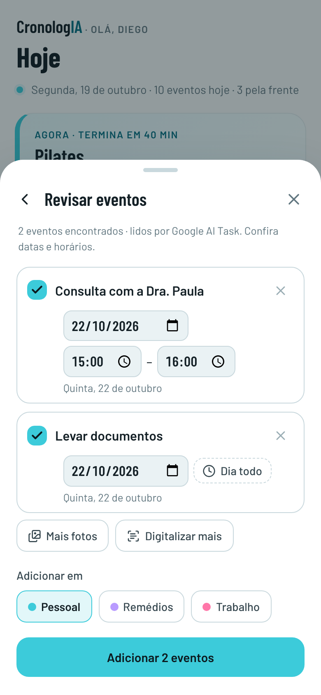

# CronologIA para Home Assistant



Um App do Home Assistant que mostra os **calendários nativos** (`calendar.*`) numa agenda bonita: o que está acontecendo agora, o mês, a semana e o dia, com cores por calendário. Cria, edita e apaga eventos nos calendários que permitem (local, Google, Outlook…) e **traz eventos de mensagens, fotos e arquivos .ics** com a IA do Home Assistant.

<p align="center">
  
  
  
  
</p>

[](https://my.home-assistant.io/redirect/supervisor_add_addon_repository/?repository_url=https%3A%2F%2Fgithub.com%2Fdiegozapella63%2Fcronologia-ha)

## Instalação

1. Toque no botão acima. Se preferir, no Home Assistant abra **Configurações → Aplicativos → Loja de aplicativos**, toque no menu **⋮ → Repositórios** e cole:
   ```
   https://github.com/diegozapella63/cronologia-ha
   ```
2. Procure **CronologIA** na loja, toque em **Instalar** e depois em **Iniciar**.
3. Ative **Mostrar na barra lateral**.

A primeira instalação leva alguns minutos, porque o app é montado no próprio Home Assistant.

## O que tem

- **Agora**: o evento que está acontecendo (e quanto falta), o próximo, os eventos do dia todo, a lista de hoje com a linha de "agora" e os próximos 7 dias.
- **Calendário** por **mês, semana, dia ou lista**, com busca do último ano ao próximo. Toque num horário vazio da semana para criar um evento ali.
- **Criar, editar e apagar** nos calendários que permitem, com **repetição** (só este ou este e os próximos) e **Desfazer**.
- **Eventos de mensagem ou foto**: cole o convite do WhatsApp, escolha um print ou fotografe um cartão de consulta; a IA configurada no Home Assistant (Claude, OpenAI, Gemini ou Ollama) encontra data, horário e local, e você revisa. Escolha qual IA em **Mais → Leitura por IA**.
- **Arquivos .ics**: importar convites e exportar os calendários.
- **Agendas**: nome, cor e mostrar/ocultar de cada calendário, sincronizados entre aparelhos.
- **Outlook, Google e Alexa**: o Outlook entra pelo MS365 Calendar (HACS) ou por um link .ics; o Google, pela integração oficial; e o que você pede para a Alexa aparece quando ela usa uma dessas agendas.
- **Tema claro e escuro** seguindo o Home Assistant.

Mais detalhes em [cronologia/DOCS.md](cronologia/DOCS.md).

## Estrutura

```
repository.yaml          repositório de apps
cronologia/              o app (config, Dockerfile, servidor Node.js)
frontend/                código-fonte da interface (Lit)
preview/                 prévia da interface com calendários de exemplo
docs/                    telas de exemplo do README
dev/fake-ha.mjs          Home Assistant falso para desenvolver sem o HA
```

## Desenvolvimento

```bash
cd frontend && npm install && npm run build      # gera cronologia/rootfs/app/www/cronologia.js
TZ=America/Sao_Paulo node dev/fake-ha.mjs        # HA falso em :8123 (token "dev")
CRONOLOGIA_DEV=1 HA_WS_URL=ws://127.0.0.1:8123/api/websocket HA_REST_URL=http://127.0.0.1:8123/api \
  HA_TOKEN=dev DATA_DIR=./.data MEDIA_DIR=./.data/media node cronologia/rootfs/app/server.js
                                                 # abre em http://127.0.0.1:8099
```

O HA falso tem calendários de exemplo (local, "Outlook", feriados e um remoto só de leitura), repetição simples e duas IAs (`ai_task.google_ai_task`, que lê fotos, e `ai_task.ollama_ai_task`, só texto). Use `FAKE_MEDIA_DIR` igual a `MEDIA_DIR` para testar a leitura de fotos, `FAKE_HA_NO_AI=1` para testar sem IA e `FAKE_HA_OLD=1` para simular um Home Assistant sem `calendar/event/subscribe`. A prévia (`preview/cronologia-preview.html`) abre direto no navegador, sem servidor.

## Créditos

[Lit](https://lit.dev) (BSD-3-Clause), ícones [Lucide](https://lucide.dev) (ISC), fontes [Barlow](https://fonts.google.com/specimen/Barlow) e [Barlow Condensed](https://fonts.google.com/specimen/Barlow+Condensed) (SIL Open Font License).
